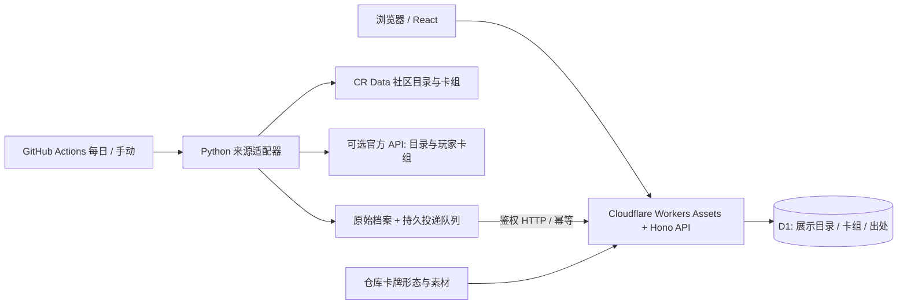

# 皇室档案：架构与数据边界

当前目标：国际服卡组浏览、基础导入链接、收藏及自配卡组。卡牌图鉴、生命值/伤害等战斗参数与历史差异已下线，不再采集参数归档或自定义参数 feed。

## 技术栈与职责

- `web/`：React、TypeScript、Vite；卡组搜索筛选、浏览器收藏、配卡与详情。
- `worker/`：Hono API；D1 查询、Zod 校验、鉴权、事务入库及卡组展示目录。
- `shared/`：前后端合同、确定性 JSON、内容 SHA-256、卡组身份与槽位规则。
- `crawler/arena/`：Python 3.12 标准库；来源适配、条件请求、原始档案、目标隔离的 outbox。
- `migrations/`：D1 顺序迁移。旧版本表与参数文件保留归档，不执行删除迁移。
- `.github/workflows/`：推送检查、每天北京时间 08:17 community 采集、可选 official 及手动部署。

网页访问不触发采集，不需要 Python 常驻服务。采集凭据只在 Worker/runner 使用，不交付浏览器。

## 来源与保留范围

| 来源 | 用途 | 边界 |
| --- | --- | --- |
| `cr-data-community` | 卡牌展示资料及社区卡组组成 | 仅为样本，特殊形态聚合，不代表热门排名 |
| `supercell-api` | 官方卡牌基础目录与指定玩家当前卡组 | 需密钥与允许的固定出口 IP；尚未完成真实密钥联网验证 |
| 仓库历史预设卡组 | 本地 seed 保留 160 条旧预设观察 | 不再抓取，非当前环境推荐 |
| 仓库形态目录与图片 | 配卡形态能力、中文名及专属素材 | 随代码更新部署，不读取旧战斗参数 |

公告简报与 `/api/balance-briefs` 已移除，网页不再加载公告数据。原公告 JSON 仅在仓库留存，不打包到 Worker。

原 `archive`、`feed` 和 `--history` CLI 入口已移除。`STATS_FEED_URL` 不再读取；每日任务也不再运行归档来源。旧 `data/releases/`、数据库 releases/card_versions/changes 中已有参数只作归档，不被参数页面或接口读取。

## 展示目录与卡组存储

`releases`、`card_versions`、`heads` 继续承载基础展示目录，以保留幂等和来源观测时间。入库只接受 community/official 两个目录流，`stats` 必须为空；目录刷新不会计算或写入 `changes`。

同内容只更新最近来源/观测时间，不创建重复版本。旧内容重放不会回退 head。所有目录、卡组与出处写入在 D1 batch 事务内执行；唯一父版本约束拒绝并发冲突，来源日期乱序返回 409。卡牌数量下降超过 10% 时拒绝入库，避免解析故障清空目录。

卡组身份按区服与排序后的卡牌/形态计算，出处独立 upsert。normal/evolution/hero/unknown 分开；不根据代表图片猜测形态。历史预设仅静态导入。自配卡组独立保存到浏览器，不写公共卡组库。

## 采集与恢复

社区数据先通过 GitHub API 固定提交 SHA，再读取对应 JSON。公开 HTTP 使用 ETag/Last-Modified 缓存，每域限速，临时错误有界重试；401/403/404/429 不反复请求，官方鉴权响应不写 HTTP 缓存。

发布前写入按目标 URL 隔离的 outbox，成功响应后删除；下一轮恢复重放。旧 archive/feed 参数、归档运行及历史预设采集消息移至 `outbox/<目标>/retired/` 留存，不再次请求网络，不阻塞有效采集。

Actions 保留 90 天 raw/runs/outbox 附件。附件不是永久数据库备份；定期通过 D1 export 备份并演练恢复。未配置官方任务时只运行 community。工作流要推送并配置 production environment 后才生效。

## API、缓存与维护

读接口保留卡组列表、配卡目录、状态及健康检查。`/api/cards/dictionary` 仅返回有效目录的基础展示资料，`stats` 恒为空。图鉴 `/api/cards`、参数详情 `/api/cards/{id}`、历史 `/api/releases`、差异 `/api/compare` 已移除并返回 404。

公开列表和状态缓存 60 秒，指定目录字典缓存一天，健康与写接口不缓存。缓存命名空间已升级以隔离下线前响应。写入成功清除当前数据中心的状态缓存；其他数据中心最多延迟 60 秒。Cache API 故障回退 D1。卡组查询使用分页和关联索引，收藏批量最多 60 个 ID。

所有写入需 Bearer secret，最大 6 MB，服务端重新验证合同。图片限已知 HTTPS 素材域名，不开放第三方代理。旧参数功能无需迁移删除；部署仍先应用兼容迁移，再发布 Worker。操作见 [部署手册](deployment.md)，接口见 [数据合同](data-contract.md)。
