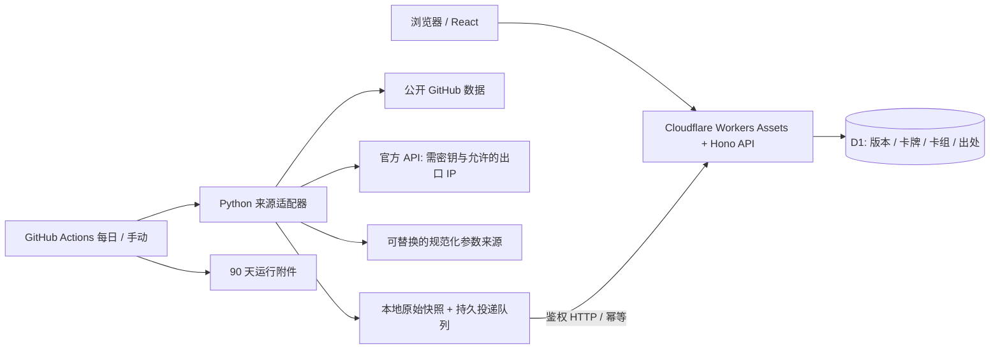

# 皇室档案：架构与数据边界

目标：国际服优先的卡组链接、卡牌参数和可追溯的参数变化资料库。参考相邻 `clash-of-clans` 项目，保留 React / Workers / D1 / Python 的部署与维护方式，不复制该项目凭据、数据库或业务模型。

## 技术栈与职责

- `web/`：React 19、TypeScript、Vite；中文响应式资料台、搜索筛选、浏览器收藏、原生 dialog 详情、字段差异。没有向浏览器交付采集凭据。
- `worker/`：Hono API；参数化 D1 查询、Zod 合同校验、鉴权、事务入库和版本比较。API 与静态资源部署为一个 Cloudflare Worker。
- `shared/`：前后端合同、确定性 JSON、内容 SHA-256、卡组身份和差异算法。
- `crawler/arena/`：Python 3.12，运行期仅用标准库；独立来源适配、HTTP 条件请求、原始档案、目标隔离的 outbox。uv 锁定开发依赖。
- `migrations/`：顺序 D1 迁移。生产迁移和发布独立，回退 Worker 不回退 D1。
- `scripts/`：本地种子、真实 Worker/D1 集成测试、部署配置、Actions 投递队列恢复。
- `.github/workflows/`：推送检查、每日采集、人工触发部署。

网站请求不运行爬虫，不依赖 Python 常驻服务器。先使用单 Worker、单 D1，避免没有实际需求的微服务和搜索服务。R2 是后续原始档案和获准图片镜像的扩展点，当前不创建空桶或把第三方 URL 做开放图片代理。

## 真实数据来源

| 来源流              | 已实现内容                                                              | 边界                                                                                                  |
| ------------------- | ----------------------------------------------------------------------- | ----------------------------------------------------------------------------------------------------- |
| `royaleapi-archive` | 2023 年的 3 个完整卡牌快照；最新归档 120 张卡牌；160 条有效预设卡组观察 | 上游参数最后更新于 2023-10-18，不代表当前版本。不是全部玩家卡组，也不是当前热门榜                     |
| `cr-data-community` | CR Data 的近期对局样本目录和 12 套卡组组成；本轮观测到 123 张卡牌       | 只覆盖样本中出现的卡牌，形态聚合，不提供 HP/伤害等战斗参数。聚合统计里的代表图片不能证明觉醒/英雄配置 |
| `supercell-api`     | 官方 `/v1/cards` 目录，配置的玩家 `/v1/players/{tag}` 当前卡组          | 需密钥与符合白名单的出口 IP；目录不是完整战斗参数。未配置凭据时没有运行验证                           |
| 自定义规范化流      | `STATS_FEED_URL` 读取独立、可替换的参数快照                             | 来源需要由维护者确认完整性、单位和更新频率，不能把此接口的存在当作已取得最新参数                      |

RoyaleAPI 与 Deck Shop 的网页请求本轮返回 403，没有绕过或伪造采集成果；本版未把 HTML 页面爬取作为可用来源。未来加 HTML 适配器时应检查 robots、站点条款、限速并做选择器契约测试，403/429 应暂停该来源。

**目前不具备“全部卡组 + 全部最新战斗参数”的数据覆盖。** 卡组组合空间庞大，正确目标是持续扩充可验证来源的收录范围，展示收录量与缺失。最新完整参数源和国服协议仍需接入；界面不会用近期采集时间掩盖旧参数。

图片默认引用公开游戏素材 URL，失败时保留名称；没有将素材授权解释为站点数据授权。参数原始输入保留到 `data/raw` 并上传 Actions 附件。素材和游戏数据归 Supercell 等权利人；公开部署前复核来源条款。CR Data 的来源和许可说明见其仓库，本站不转载攻略全文或其应用代码。

## Git 思想如何落地

`releases` 是 commit，`card_versions` 是该 commit 的文件快照，`changes` 是父提交之间的 gameplay diff，`heads` 指向每个来源流的当前 commit。

1. 卡牌的稳定身份是官方数值 ID，译名和图片不参与身份。
2. 每份卡牌文档按 ID 排序，递归按键排序后计算 SHA-256。commit ID 还包含来源流和上游 revision；采集时间不参与内容 hash。
3. 每个来源流独立线性历史，不跨来源做平衡差异。卡牌快照不可覆盖，不删除历史。
4. 首个版本是 baseline，不把所有卡牌误报为新增平衡调整。后续新增/移除/修改分别记录。
5. diff 保存精确字段路径、旧值、新值、百分比；旧值为零时不计算百分比。数组按来源索引比较，不能假设不同稀有度的索引都是同一个游戏等级。
6. 名称、描述、翻译、图片变化会更新完整文档，但不算战斗参数变化。组件保留上游全部非身份、翻译、视觉/音效字段，覆盖圣水、部署、攻击、生命、射程、召唤、投射物、buff 及按等级数组；未知机制字段也保留原名，避免白名单漏掉新机制；原始输入仍单独保存。
7. 上游源码时间是历史版本日期。官方 API 没有提供参数生效日期，官方目录的版本时间只表示观测时间。检测时间不等于游戏生效时间。
8. 页面叫“检测变化，待核对公告”，不根据数值方向自动推断增强/削弱。官方公告的确认、有效时间、审核备注应作为可追加的 release annotation 实现，不能改写原始快照；该审核模块属于后续功能。

默认保留完整规范化文档而不是只保存增量。初期体积更可控、审计和任意版本比较简单。长期数据增长后按文档 hash 把相同 card blob 去重，再让 commit 引用 blob；不需要改变 API 的 release ID 模型。查询默认分页；版本时间线每 30 个版本加载更多。

## 原子性、幂等与并发

入库先读取流当前 head 和旧快照，再计算差异。所有 release、card version、change 和 head 更新在同一个 D1 batch 事务内执行。唯一索引 `(stream, COALESCE(parent_id,'ROOT'))` 禁止两个并发任务接在同一父版本之后；失败事务整体回滚，返回 409。源码日期不晚于 head 的新内容也返回冲突，防止乱序发布回退参数。

相同 commit 重放返回原 ID；完全相同内容的新版观察不创建额外 commit；`heads` 独立更新最近来源日期与观测时间，既保持提交不可变，也避免内容未变化时被误判为很久未检查。重放旧 commit 不移动 head。来源卡牌数量突然下降超过 10% 时拒绝发布，避免异常解析把大批卡牌当作移除。正规大规模下线必须先人工确认并调整这条保护规则。

历史初始化必须从旧到新在空流发布；已有新 head 后不能把缺失的旧版本强行接到末尾。当前历史导入用 `--history 3` 做首次引导。后续如需回填更早历史，应编写独立迁移/重建流工具并保留现有 IDs；尚未实现该工具。

卡组身份是 `SHA256({region, sorted [{id,variant}]})`，同一组成的卡牌排列不重复收录；普通/觉醒/英雄/未知形态区分，不用未知数据冒充正常形态。`deck_origins` 保留多个出处；不存在或临时不可达的来源不触发删除。`hidden` 是预留维护标记，目前没有公开管理界面。

基础分享链接按八个 ID 生成，尚未在游戏内验证，不承诺特殊槽位自动导入。国际服域名独立集中在共享链接函数中；国服以后增加 region adapter，不复用国际服链接。

## 采集和恢复

GitHub API 先取得上游 commit，所有输入文件用同一 SHA 固定，避免一次采集跨越两份上游版本。公开 HTTP 请求缓存 ETag / Last-Modified 与响应；304 仍从缓存解析。每域至少间隔 1 秒，最多 3 次暂时故障重试，单响应上限 8 MB。401/403/404/429 不反复重试。只允许配置的 HTTPS 域名，跨主机重定向拒绝；官方鉴权响应不写 HTTP 缓存。

原始输入与规范化 JSON 原子落盘；发布前写入目标 URL 隔离的 outbox，收到成功响应才删除。请求超时保留消息，下次先重放。D1 是幂等最终边界。每个来源独立 job，并发组串行；失败不清空线上内容。

Actions 每次上传 90 天 raw/runs/outbox 附件，下轮恢复该来源最近附件的 outbox；HTTP cache 只是加速。附件恢复损坏让任务失败，不当作成功跳过。超过保留期只能从仍存在的上游重新抓取；需要永久原始证据时应扩展到 R2 或其他长期归档，不把 GitHub 附件称作永久备份。

官方密钥存在 IP 白名单限制。GitHub hosted runner 出口 IP 不稳定，因此官方来源支持 `OFFICIAL_RUNNER` 自托管固定出口 runner。没有配置官方任务时默认只运行公开来源。任何一个正常采集流程都不依赖用户网页访问。

## API、缓存与维护

公开只读 API 使用分页，最大 48 条；收藏批量最多 60 ID，出处按页一次查询，无 N+1。数据库 LIKE/JSON 索引查询适合初期，流量证明需要时再引入 FTS 或卡组成员关系表。

公开列表缓存 60 秒；按 release 读取和任意双版本比较缓存 1 天，因为内容不可变。`status` 与 `health` 不缓存；写入接口禁止缓存。Cache API 故障回退 D1。可变列表的浏览器 max-age 为零、共享缓存 s-maxage 为 60，避免浏览器再次延长过期时间。写入后列表可能最多延迟 60 秒，既有浏览器页面需刷新；本版没有宣称即时全局缓存失效。跨来源切换不会把旧请求响应展示到新来源里。

写入接口 Bearer secret 缺失时 fail closed；请求体按流限制 6 MB，服务端重验 schema；SQL 全部参数化；图片 URL 使用已知域名白名单；不把任意外部 URL 转为服务器代理。生产可在 `/api/ingest/*` 外再加 Cloudflare Access 服务凭据，但需同步更新采集客户端。

来源运行状态入 D1，Actions 失败会退出非零。定时运行不是精确 SLA；GitHub schedule 可延迟或因不活跃而停用。建议外部监控 `/api/health` 和来源最新成功时间，告警阈值按来源区分；参数鲜度必须基于来源更新时间。定期导出 D1，做恢复演练；部署前扩展迁移、再发兼容代码，破坏性迁移单独评审。

## 扩展顺序

1. 部署到自己的 Cloudflare 账户，配置生产 secrets，验证一次采集与备份恢复。
2. 接入可持续取得的最新完整参数源，并确认等级、形态、单位、来源授权和生效日期；为每个源建固定 fixture 契约测试。
3. 增加官方公告审核注释、失效反馈、Access 后台和来源鲜度告警。
4. 增加国服适配、卡组详情 URL、SEO/预渲染与社交分享图；当前 SPA 不具备完整 SEO。
5. 需要分享整张卡组图片时，增加服务端栅格合成与 R2 内容寻址存储；当前已显示真实卡牌组成图，没有承诺可下载合成图片。

官方参考：[Workers 静态资源](https://developers.cloudflare.com/workers/static-assets/get-started/)、[D1 batch 事务](https://developers.cloudflare.com/d1/worker-api/d1-database/)、[Supercell 开发者入口](https://developer.clashroyale.com/)、[RoyaleAPI 数据](https://github.com/RoyaleAPI/cr-api-data)、[CR Data 来源](https://github.com/jayclim/CR-Data)、[粉丝内容政策](https://supercell.com/en/fan-content-policy/)。
